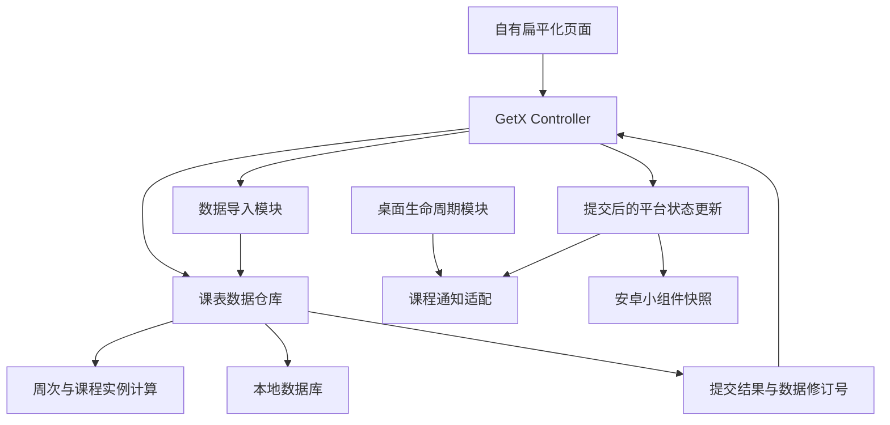

# QingheApp 设计文档

> 状态：业务与技术设计提案，基础工程已经建立。  
> 基线日期：2026 年 11 月 21 日。  
> 产品范围：[PROJECT.md](PROJECT.md)。贡献约束：[AGENTS.md](../AGENTS.md)。

本文只维护信息架构摘要、业务规则和技术方案。具体视觉风格由用户另行设计，不在本文规定配色、尺寸或组件外观。

本文把已确认的产品要求转化为页面、数据模型、操作规则和模块接口。除产品文档列明的用户决定外，本文的字段、默认值、模板和接口名称均属于工程提案；实现前应通过样例与平台验证收敛，不表示已有对应代码或依赖。

快速定位：

- [页面与交互](#2-信息架构与页面设计)、[界面实现边界](#3-界面实现边界)。
- [模块架构](#4-架构与模块职责)、[数据模型与课表计算](#5-领域术语与数据模型)。
- [数据导入与合并](#6-数据导入与合并)、[课程通知](#7-课程通知与平台生命周期)、[安卓小组件](#8-安卓小组件)。
- [错误与隐私](#10-错误处理与隐私)、[验证计划](#11-验证计划与用例矩阵)、[实施入口](#12-待验证清单与实施入口)。

## 1. 设计原则与关键约束

1. **本地数据是运行基础。** 页面展示和编辑读取本地持久化数据，网络状态不参与正常课表的可用性判断。
2. **共享规则，分别适配系统。** 三端共用课程计算、校验和合并规则；通知、托盘和安卓小组件按系统能力实现。
3. **先确保默认体验，再提供自定义。** 自定义改变展示参数，不改变课程数据的含义，也不要求用户先配置才能使用。
4. **一次课与重复安排分开表达。** 单次调课以原始发生日期为锚点，不能直接改写整条重复规则。
5. **预览不产生业务写入。** 导入差异与用户选择完成后，再通过一次本地事务提交。
6. **只建立当前需要的模块。** 本地日历复用课程实例查询；暂不建设云同步、通用插件系统、自由布局编辑器或独立日历事件引擎。

Flutter 官方介绍了通过仓库协调数据来源的离线架构；本项目采用更明确的本地工作约束，当前不引入远程同步数据源。[Flutter 离线架构说明](https://docs.flutter.dev/app-architecture/design-patterns/offline-first)

## 2. 信息架构与页面设计

### 2.1 页面职责

| 页面 | 核心内容 | 主要操作 |
| --- | --- | --- |
| 首页 | 今日概览、当前课或下一节课、日历入口 | 查看当天课程、打开日历 |
| 周课表 | 单行工具栏、七天与全部节次的完整网格 | 切换周次、返回本周、查看课程、新建课程 |
| 我的 | 个人资料摘要、我的课程、课表与偏好设置 | 查看课程、编辑资料、管理学期或再次导入 |
| 本地日历 | 月视图、选中日期、当天课程 | 切换月份、返回今天、查看课程详情 |
| 课程详情 | 课程信息、重复安排、单次调整、个人备注与提醒 | 编辑课程、调整本次课、补课、设置提醒 |
| 课程编辑 | 基本信息与一条或多条上课安排 | 校验、保存、取消 |
| 个人信息 | 学校选择与选填昵称 | 搜索学校、手动填写学校、保存或跳过 |
| 课表导入 | 目标学期、学期与节次配置、三种导入来源、差异预览 | 保存空课表、选择资料来源、解决冲突并确认导入 |
| 个性化设置 | 外观、字段、布局、通知和平台设置 | 预览配置、保存、恢复默认 |

日历复用本地课程查询。个人信息保存在本机，无需青禾账号。

### 2.2 首次使用与空状态

首次引导结束后进入两页设置流程：

```text
引导结束 → 个人信息 → 课表导入（含学期与节次配置、确认预览）→ 主界面
```

- **1 / 2 · 个人信息。** 学校可以搜索选择，也可手动填写。目录只对已验证的学校标记「支持教务导入」。昵称选填，主按钮为「继续」，次按钮为「稍后填写」。学校和昵称保存在本机，不要求学号、手机号或学校账号。
- **2 / 2 · 课表导入。** 顶部显示当前学校和目标学期，下方提供「教务系统」「CSV 模板」「JSON 文件」三个入口。首次用户可以直接选择来源，文件给出的配置作为草稿；缺少学期信息时在当前页补齐。选择来源、进度、预览和错误都留在这页。已有学期时可以选择该学期或新建。也可登录前先检查学校支持状态、只保存空课表，或点击「稍后导入」进入主界面。
- 「我的」提供这两页的返访入口，进入时读取已保存信息。重新查看引导不会清空资料、重置首次设置进度或覆盖课表。

**课表配置。** 必填项为学期名称、第一教学周和总周数；节次表可载入现有默认值，也可编辑每节开始时间、统一每节时长及节次数量，自动算出结束时间。第一教学周显示实际日期范围。切换学期加载该学期的节次表；修改已有配置时先检查受影响课程，存在越界周次或失效节次时定位相关安排，修正后才能保存。节次规则只在一处保存，由课表、首页和「我的课程」共同读取。

不同空状态要区分原因：

- 没有学期：引导建立学期及节次表。
- 已有学期但没有课程：提供手动建课和模板导入。
- 这一周没有课：保留日期与周次，明确显示本周无课。
- 隐藏周末但周末有课：提供可发现的查看入口，不将其误报为无课。
- 日期不在学期范围内：显示日期与范围说明，不强制归入第 1 周。
- 本地读取失败：保留错误说明与重试入口，不自动清空或覆盖数据库。

**「我的」课程组件。** 页面顶部显示学校与昵称，下面是独立的「我的课程」卡片。卡片显示当前学期、课程总数和本周上课次数，预览时间最近的三次尚未结束的课。例如，一门课在本周上两次，课程总数计一门，本周上课次数计两次。每行默认展示课程色点、课名和时间，地点、教师可设置显隐。点击课程打开现有详情；「查看全部课程」打开独立面板，按课程分组展示上课安排。没有课程时卡片显示「导入课表」入口。组件使用现有中性背景与主题色，复用真实课表数据；引导插画和外观预览的示例课不计入统计。

### 2.3 响应式布局

布局优先根据可用宽度和内容空间选择，而非只判断操作系统；实现时结合字号、长文本和实际窗口验证断点与最小可用空间。

安卓窄屏与桌面窄窗口共享完整周总览规则；默认不能通过只展示三列日期完成适配。若用户主动改变显示范围，要保留查看隐藏日期的入口。

### 2.4 周课表与课程卡片

完整周总览优先展示课程名，有空间时补短教室编号；节次由网格位置表达，完整时间、教师和备注进入详情，避免重复文字挤占空间。自定义字段不能破坏默认完整网格。

课程状态使用文字或图标配合颜色表达，不能仅用颜色区分当前课程、调课或时间冲突。长名称允许换行或截断，并可在详情中完整读取。重叠课程都应保留并提示冲突，不静默隐藏后写入的课程。

周次切换与日期选择必须同步更新标题、课程、今日标记和可见日期。快速连续操作后，最终展示以最后一次选择为准，不能混入上一周的异步结果。

### 2.5 核心交互边界

| 操作 | 默认结果 | 防止误操作的处理 |
| --- | --- | --- |
| 编辑课程基本信息 | 修改该课程对应信息 | 页面说明影响范围 |
| 修改一条上课安排 | 影响该安排包含的多个教学周 | 保存前展示受影响范围及已有单次调整 |
| 调整本次课 | 只修改选中的原始发生日期 | 标示原时间与新时间 |
| 停课 | 隐藏一次实际上课，不删除重复安排 | 可查看并撤销该次调整 |
| 补课 | 新增一次具体日期的课 | 不自动取消其他日期的课 |
| 恢复默认展示 | 重置所选设置分组 | 不删除课程或导入记录 |
| 取消导入 | 退出当前导入草稿 | 本地课表保持不变 |

停课和撤销是单次调整模型的配套提案，具体入口在正式页面实现中验证；不扩展为复杂的操作历史系统。

## 3. 界面实现边界

### 3.1 组件职责

可以复用 Material 的输入、焦点、语义等基础能力。页面组件只负责呈现与收集输入，业务规则放在 Controller、Repository 或领域模块中。主题及具体组件外观由用户设计后再接入。[MaterialApp 说明](https://api.flutter.dev/flutter/material/MaterialApp-class.html)

### 3.2 动画职责

具体动画参数由用户设计。实现必须允许快速操作取消或接续旧动画，不排队播放已经过时的状态；降低动画时仍应保留清楚的即时反馈。

不让业务提交依赖动画完成；数据库保存失败时，界面须回到明确的未保存状态。课程列表的稳定标识与日期绑定，避免重绘时把另一门课错误地衔接为同一卡片。

### 3.3 可访问性与输入方式

为图标按钮提供语义标签，支持键盘焦点和基本导航；触控区域不能因外观紧凑而难以操作。验证系统字号变化、深浅模式、长文本、背景透明与减少动画等情形。可访问性是页面验收的一部分，而不是另做一套主题。[Flutter 可访问性说明](https://docs.flutter.dev/ui/accessibility)

## 4. 架构与模块职责

模块（Module）通过清晰接口（Interface）封装业务行为；实现（Implementation）内部可以拆分计算与存储。仅在安卓、Windows、Linux 确实存在差异的位置使用平台适配实现（Adapter），不为每个类机械增加抽象接口。



图中的平台状态更新由应用级协调代码执行；不是只存在于某个页面生命周期中的订阅。核心数据提交先完成，通知或小组件失败不回滚已经保存的课程。

### 4.1 GetX 的使用范围

GetX 用于页面状态、依赖组织和路由管理，这与其项目文档描述的能力相符。[GetX 项目说明](https://github.com/jonataslaw/getx#readme)

- 页面 Controller 管理选中周次、加载与提交状态，解析和持久化由各自模块完成。
- 通过 Bindings 组织页面依赖；应用级数据库和平台模块在应用启动阶段装配。
- 业务模块通过显式依赖获取仓库和时钟，避免在纯计算代码中到处查询全局对象。
- 响应式状态是已提交本地数据的展示，不作为唯一持久化副本。
- 页面销毁时释放订阅和交互资源；后台提醒不能依赖已被销毁的页面 Controller。

### 4.2 最小模块接口提案

| 模块 | 代表性操作 | 封装的主要行为 |
| --- | --- | --- |
| 课表数据仓库 | 查询某周、保存课程、应用单次调整 | 规则校验、事务、数据修订号 |
| 课程计算 | 展开日期范围内的课程实例 | 教学周、重复安排、单次调整、时间冲突 |
| 数据导入 | 读取 CSV／JSON 或学校来源、生成预览、提交已确认预览 | 各来源解析成同一份课程草稿，共用校验、差异、冲突和基线更新 |
| 设置模块 | 读取、更新、恢复指定分组 | 默认值、参数范围、持久化 |
| 通知适配 | 查询能力、更新计划、取消计划 | 系统权限、调度标识、生命周期 |
| 小组件适配 | 更新快照、处理打开入口 | 可见数据、快照版本和课程定位 |
| 桌面生命周期 | 关闭到托盘、恢复窗口、主动退出 | 窗口与进程状态、启动设置 |

方法名称是说明性提案，不要求为表中每行建立一个继承体系。只有确实需要替换的平台实现或测试依赖才建立相应接口。

### 4.3 目录提案

```text
lib/
  main.dart
  features/
    timetable/
    course/
    import/
    settings/
  data/
    models/
    repositories/
    local/
  services/
    notifications/
    widgets/
    desktop/
test/
  data/
  features/
  services/
assets/
```

目录按实际代码逐步创建，当前不生成空目录树。平台原生工程目录由 Flutter 初始化产生，不手工伪造。数据库和平台依赖尚未选定，不在本文固定未经测试的插件版本。

## 5. 领域术语与数据模型

### 5.1 术语

| 术语 | 含义 | 例子或限制 |
| --- | --- | --- |
| 学期 | 一组共享教学周与节次配置的课程范围 | 不同学期的数据不能误合并 |
| 教学周 | 相对本学期第一教学周的周序号 | 不等于自然年的第几周 |
| 课程 | 课程身份及基本信息 | 同名课程不一定是同一门课 |
| 上课安排 | 某课程在指定周次和星期重复发生的规则 | 同一课程可有多条安排 |
| 课程实例 | 某条安排在某个具体日期发生的一次课 | 由规则计算产生 |
| 单次调整 | 对某个原始课程实例进行停课或调课 | 不直接改变整条重复安排 |
| 补课 | 与课程关联的一次额外上课 | 用具体日期表达 |
| 导入来源 | 同一批外部数据的持续身份 | 与本地文件名不是同一概念 |
| 导入基线 | 上次成功接收的来源字段快照 | 用于判断双方是否分别改动 |

### 5.2 实体与关键字段

以下为逻辑模型，字段名称不是已经落地的数据库结构。

| 实体 | 关键字段 | 约束 |
| --- | --- | --- |
| 学期 Semester | 本地标识、名称、第一教学周周一、教学周数、节次表、时区 | 教学周数为正；学期日期采用日历日期语义 |
| 本机资料 StudentProfile | 选填昵称、目录学校标识或自填学校名称 | 资料和课程可分别保存；更换学校不改写历史课表 |
| 课程 Course | 本地标识、所属学期、名称、类型、来源信息、个人配置 | 本地标识稳定；名称不是唯一键 |
| 上课安排 ScheduleRule | 标识、课程标识、星期、周次集合、起止节次、教师、地点、来源备注 | 星期为 1 至 7；周次和节次必须在范围内 |
| 单次调整 LessonChange | 标识、安排标识、原始日期、调整类型、目标日期与时段、覆盖字段 | 同一原始实例只保留一个有效调整状态 |
| 补课 ExtraLesson | 标识、课程标识、日期、时段、教师、地点 | 明确关联课程，但不修改重复规则 |
| 个人课程配置 CoursePreference | 课程标识、配色、个人备注、提醒覆盖规则 | 不由外部数据直接覆盖 |
| 导入来源 ImportSource | 标识、学期标识、类型、显示名称 | 不依赖机器路径或文件名作为身份 |
| 来源映射 ImportMapping | 来源标识、外部编号、本地标识、上次接收快照 | 在来源及学期内保证编号唯一 |
| 展示设置 DisplaySettings | 主题、字段顺序、字号、布局与动效参数 | 使用受约束的参数值 |

教师、地点和来源备注放在上课安排中，允许同一门课程的不同上课安排使用不同值。课程类型先满足普通课程与实验课程；不预先建立复杂分类系统。

“个人备注”与“来源备注”分开保存：用户选择保留个人备注时，不应导致来源备注的更新被误当作已经接收，或在下一次导入中反复冲突。

### 5.3 时间与教学周规则

以学期第一教学周的周一作为 week1Monday。用户选定的开学日期若不是周一，界面明确展示映射到的第一周范围，避免隐式向前取整后出现理解偏差。

```text
教学周 = floor(日历日期差(目标日期, 第一教学周周一) / 7) + 1
```

实现时按日历日期计算差值，不把两个时刻相减后直接除以 24 小时来模拟日期差，以免时区或夏令时变化造成错误。超出 1 至学期教学周数的日期，不展开普通重复安排。

单双周依据教学周编号判断。界面中的“单周”“双周”是周次集合的便捷输入，保存前规范化为去重且排序的整数集合；不把自由文本当作唯一业务表达。

节次结束时间取结束节次的结束时刻。开始节次不得大于结束节次；节次时间表按顺序校验。跨越课间的连续节次仍属于同一条上课安排。

同日时间冲突采用半开区间判断：一门课结束时刻等于另一门课开始时刻，不视为重叠。日期使用学期时区解释；转换系统调度时刻后才使用带时区的时间信息。

学期时区提议采用学校所在地时区，首个目标可使用 Asia/Shanghai；不跟随设备临时切换时区而悄悄改变课程含义。具体跨时区展示策略在实施提醒时验证。

### 5.4 课程实例展开顺序

1. 按查询日期范围筛选重复安排，依据星期和教学周集合生成原始实例。
2. 按“安排标识 + 原始发生日期”定位有效单次调整。
3. 停课移除原始实例；调课移除原始实例并生成调整后的实例。
4. 同时查询目标日期落在当前范围内的调课，即使原始日期位于另一周，也要显示。
5. 合并范围内的补课，按日期和时间排序，并计算冲突标记。

调课后的实例身份继续关联原始发生日期，不能因为目标日期变化而生成另一个无法追踪的原始实例。撤销调整后恢复原安排。

**示例：** 某课程原定第 3 周星期一上课，调整到第 4 周星期二。第 3 周不再显示原实例，第 4 周显示调入实例，其他周不受影响；若第 4 周另有原定课，两次课都保留并检查是否冲突。

修改或重新导入重复安排时，必须检查已有单次调整。原始实例已不再成立的调整应在确认界面中处理，不能留下无法定位的孤立记录。

### 5.5 本地存储与事务

建议采用支持事务与结构化查询的本地数据库。SQLite 是候选方案，但 Flutter 绑定、三端原生依赖和迁移方式需要工程验证后确定；当前不宣称任何具体插件已经兼容全部目标。

一次保存必须同时维护实体、来源映射和本地修订号。导入事务失败时全部回滚；页面状态不能显示半成功数据。

使用数据库结构版本管理迁移。升级失败应保留原数据并展示错误，不以删除数据库作为默认恢复手段。测试使用虚构数据，应用内部必要的存储路径不写入日志或文档。

## 6. 数据导入与合并

### 6.1 CSV 格式提案与身份标识

CSV 来自本软件提供的模板，不提供任意列映射编辑器。下面提出模板 v1，尚待填写体验与重导入样例验证；模板版本是格式版本，不是软件发布版本。

一行代表一条上课安排。为可靠处理重复导入，模板提议使用稳定的课程编号和安排编号。编号只是表内身份，可使用简短虚构值，不要求填写学号等个人信息。

| 列名 | 是否必填 | 规则与用途 |
| --- | --- | --- |
| 课程编号 | 是 | 同一课程的多行共用编号；同名课程可使用不同编号 |
| 安排编号 | 是 | 同一导入来源内唯一；后续修改时间地点时保留编号 |
| 课程名 | 是 | 去除首尾空白后不能为空；同一课程编号的名称应一致 |
| 课程类型 | 否 | 普通或实验；空值按普通课程解释 |
| 星期 | 是 | 整数 1 至 7，分别代表周一至周日 |
| 周次 | 是 | 采用下述规范语法，不能超出所选学期 |
| 开始节次 | 是 | 所选学期节次表中的正整数编号 |
| 结束节次 | 是 | 不小于开始节次，且存在对应节次 |
| 地点 | 否 | 对应该条上课安排的地点 |
| 教师 | 否 | 不要求用户填写个人信息；示例留空或使用占位符 |
| 来源备注 | 否 | 外部提供的备注，与个人备注分别保存 |

相较于早期仅包含展示字段的草案，本提案增加两个稳定编号，以避免“改了上课时间就被当成新课”。代价是填写步骤增加；模板冻结前需用实际虚构样例验证是否足够清晰。若取消稳定编号，必须同时重新设计可靠的匹配与人工确认规则，不能退化为按课程名称自动覆盖。

学期和导入来源在导入界面选择，不重复填写在每行中。首次导入建立来源，再次导入可选择原来源；不通过文件路径、文件名或行号推断来源身份。

### 6.2 周次、编码与示例

- 建议采用 UTF-8 编码，兼容文件开头的 UTF-8 BOM。
- 表头使用固定中文名称；缺失必填列或重复列名时阻止提交。未知列提示检查模板，不静默解释为业务字段。
- 周次允许单值、闭区间及组合，例如 3、1-16、1,3,5、1-8,10-16。
- 单双周在编辑界面通过快捷选择转换为明确集合，CSV v1 不引入额外的“单双周”文本语法。
- 带逗号、双引号或换行的字段按 CSV 引号规则处理，不能使用简单的字符串逗号分割。

以下仅为格式示例，不代表真实课程或个人信息：

```csv
课程编号,安排编号,课程名,课程类型,星期,周次,开始节次,结束节次,地点,教师,来源备注
C001,R001,示例课程甲,普通,1,1-16,1,2,示例教室,,
C001,R002,示例课程甲,普通,3,"1,3,5,7",3,4,示例教室,,单周安排示例
C002,R003,示例实验乙,实验,5,2-8,5,6,示例实验室,,
```

CSV v1 仅规定按教学周与节次的安排。具体日期、非标准时段的实验数据在学校适配时验证，再决定是否扩展可交换格式。

### 6.3 导入状态与校验

```text
选择来源与目标学期 → 读取课程 → 核对学期与节次 → 解析和校验 → 差异预览 → 解决冲突 → 事务提交 → 更新界面与平台状态
```

预览阶段不创建正式课程或来源映射。新来源及其编号关系也在确认时提交，取消操作不留下业务记录。

预览先展示新增课程、更新安排和冲突数量，再按问题定位到 CSV 行或 JSON 字段。发现上课时间重叠时提示用户核对；双方均为合法安排时可确认保留，来源与本地的同一字段冲突必须明确选择后才能提交。

校验至少覆盖：

| 层次 | 错误示例 | 处理 |
| --- | --- | --- |
| 文件与结构 | 编码无法识别、表头缺失、引号不完整 | 解释结构错误并阻止提交 |
| 行字段 | 课程名为空、星期为 0、周次格式错误 | 标明数据行及列，不输出敏感原始值到日志 |
| 学期约束 | 第 30 周超出学期范围、节次不存在 | 提示对应学期规则，不自动截断 |
| 文件内一致性 | 同一安排编号出现不同内容、同一课程编号名称不一致 | 要求修正冲突，避免最后一行覆盖前一行 |
| 本地关系 | 安排编号被重新关联到另一课程、已有调整将失去原始实例 | 在预览中明确处理，不自动删除关联数据 |

整份导入默认要求阻断性错误全部解决后才能提交；不默默跳过错误行生成部分课表。错误列表和预览支持修正字段，原始文件不被自动改写。

### 6.4 重复导入与三方比较

使用“导入来源 + 外部编号”定位本地映射。对来源可管理的字段比较三份值：

- B：上次成功接收的来源基线。
- L：当前本地有效值。
- I：本次输入值。

| 情况 | 合并结果 |
| --- | --- |
| I 与 B 相同 | 来源未改变，保留 L，包括本地修改 |
| L 与 B 相同，I 改变 | 作为来源更新展示，确认后接收 I |
| L 与 I 相同 | 无实际冲突，合并为同一值 |
| L 与 I 都相对 B 改变且结果不同 | 标记字段冲突，要求选择本地值或输入值 |
| 没有历史映射 | 展示为新增；同名仅作人工判断提示，不自动认定同一课程 |

配色、个人备注和提醒不在来源字段覆盖范围中。来源字段例如课程名、周次、教师和地点可以参与比较；某一字段的规范化方式必须在 B、L、I 三份数据中一致。

成功提交后，来源基线记录本次接收的 I，本地保存用户最终选择的有效值。若用户保留了本地值，后续相同文件不应再次把它误报为新的来源冲突。

各来源默认采用新增与更新语义：某编号未出现在新数据中，不推断该课程已被删除。首次导入选错来源、编号被改动或课程归属变化时，应让用户核对，不能借助名称猜测自动覆盖。

### 6.5 提交一致性

预览携带创建时的本地数据修订号。确认时若学期、课程或来源数据已经改变，重新生成差异，不能按过期预览覆盖新编辑。

事务内一次完成已确认的学期配置、课程、安排、来源映射、基线和修订号更新；使用预览状态或提交标识阻止同一次确认重复写入。事务完成前禁用重复提交，但不以按钮禁用代替数据层保护。

通知与小组件更新发生在事务提交之后。更新失败时保留已保存的课表，显示受影响状态，并在下次恢复或主动重试时重建；不要求用户重新导入同一文件来修复平台状态。

### 6.6 青禾 JSON v1

JSON 文件需包含整数版本号 `version` 和课程数组 `courses`，可附带 `semester`。课程与上课安排各有稳定编号，周次使用整数数组。课程和安排的编号只在目标学期与导入来源内用于匹配；示例均为虚构。

```json
{
  "version": 1,
  "semester": {
    "name": "示例学期",
    "week1Monday": "2026-09-07",
    "weekCount": 18,
    "periodStartTimes": ["08:00", "08:55"],
    "periodDurationMinutes": 45
  },
  "courses": [
    {
      "id": "C001",
      "name": "示例课程甲",
      "rules": [
        {
          "id": "R001",
          "weekday": 1,
          "weeks": [1, 3, 5],
          "startPeriod": 1,
          "endPeriod": 2,
          "location": "示例教室"
        }
      ]
    }
  ]
}
```

课程可选 `type`（`regular` 或 `lab`，默认为 `regular`）；安排可选 `location`、`teacher` 和 `sourceNote`。省略学期时使用当前页选定的配置；文件中的学期字段只填入草稿，与已有设置不同则提示核对，不直接覆盖。未知版本、无效日期、空课程／安排列表和字段类型不符均返回可定位的错误。V1 仅承载课表和节次配置，个人资料、个人备注与提醒不来自导入文件。

### 6.7 学校教务来源

使用「个人信息」选择的学校筛选可用来源。用户从学校官方入口导出课表，或在学校官方页面完成需要的登录；仅为已验证的导入方式显示可用按钮。兼容性按学校、来源和平台记录，实验课来源单独说明。转换得到的课表草稿与文件使用同一套确认和合并流程。有官方稳定编号时沿用其身份；无法稳定匹配时提示人工核对。未选择学校时可返回「个人信息」，未适配、取消登录或者来源暂时不可用时可切换 CSV／JSON。

## 7. 课程通知与平台生命周期

### 7.1 提醒规则提案

当前只提供普通课程通知，不提供持续响铃和贪睡式闹钟。建议设置全局默认提前时间，并允许课程选择继承、关闭或指定提前时间；“未设置”与“明确关闭”必须是不同状态。

提前时间以分钟保存为非负整数。具体默认值、最大值和是否允许多次提醒尚未冻结；初期按每次课程一条提醒设计，不擅自增加多阶段提醒。

实际提醒目标为课程实例的开始时刻减去提前时间。停课不提醒，补课与调课按实际发生时刻重新计算。修改全局设置、单门规则、课程安排、节次表或学期时区后，要替换受影响的计划。

### 7.2 计划身份与重建

通知计划关联稳定的课程实例身份，不只按课程名编号。平台若仅接受整数通知标识，需要维护可追踪映射并处理碰撞，而不是假定任意哈希永不重复。

每次重建先比较应有计划与已有计划：取消失效项，替换变更项，保留未变项。应用重启或设置变更后重复执行不应叠加多条相同通知。

计划覆盖范围以平台实际支持为准。若必须分批安排，需要验证后续批次的补充机制并清楚说明覆盖边界，不能把“用户每天打开应用”当作未告知的准点提醒前提。具体上限和保障策略是 M0 必须验证的事项。

### 7.3 安卓调度约束

系统通知与调度是两件事：普通通知描述呈现方式；何时触发取决于系统调度、权限和进程状态。Android 提供在应用进程之外执行定时操作的机制，但精确与非精确调度有不同约束，不能从接口存在推断所有设备都能准点触发。[Android 定时任务说明](https://developer.android.com/develop/background-work/services/alarms)

后台周期任务的具体执行时间受到条件和系统优化影响，因此不将 WorkManager 视为严格的课程时刻计时器。[Android 后台任务约束](https://developer.android.com/develop/background-work/background-tasks/persistent/getting-started/define-work)

实施时分别验证通知权限、提示音、所需调度能力、设备重启后计划恢复和用户强制停止后的行为。权限不足时仍可使用课表，并说明提醒不可用或可能延迟；不反复阻断主界面。

### 7.4 桌面运行状态

| 状态 | 窗口 | 进程 | 课程提醒 |
| --- | --- | --- | --- |
| 正常使用 | 可见 | 运行 | 按配置工作 |
| 关闭到托盘 | 隐藏，可恢复 | 运行 | 继续工作 |
| 主动退出 | 关闭 | 结束 | 停止 |
| 系统休眠或关机 | 不保证可交互 | 受系统控制 | 不保证按时送达 |

主动退出前清理本软件的桌面提醒计划，避免使用系统调度的适配实现仍在退出后发出通知。恢复窗口时保留已选周次和未丢失的页面状态；未保存表单按普通离开页面规则处理。

从休眠恢复时重新对齐当前时间和后续计划，默认不集中补发已过期课程通知。托盘不可用时保留可见入口，并让用户理解关闭行为。开机启动只有在实际设置成功后才显示为启用。

## 8. 安卓小组件

### 8.1 展示范围

建议提供“今日课程”和“下一节课”两种展示。每个实例独立保存展示字段、主题、透明度等配置；不要求把应用内部的复杂课表网格完整塞进桌面小组件。

Android 小组件属于系统桌面的快速信息入口，其可用布局和交互由系统机制约束，需要单独适配，不能直接认定 Flutter 页面组件可原样复用。[Android 小组件说明](https://developer.android.com/develop/ui/views/appwidgets/overview)

### 8.2 快照与数据来源

主应用从本地仓库生成最小展示快照，包含日期、课程实例标识、必要的文字、时间、样式和数据修订号。平台读取快照，不依赖某个页面 Controller 仍然存活。

更新采用完整快照替换，避免读取到部分更新。通知和小组件都依据同一份课程实例计算结果，不能各自实现一套单双周和调课规则。

触发刷新包括课程提交、导入完成、相关设置变化、应用恢复以及系统允许的日期或计划刷新。跨午夜、学期边界、调课到另一周和设备重启是重点验证情形，不承诺所有后台状态下立即刷新。

### 8.3 点击与失效处理

点击课程携带内部实例标识和日期进入详情；启动后重新从仓库验证，不信任快照中可能过期的完整课程内容。课程已删除或调整时，定位到对应日期并提示状态变化。

没有课程、没有学期和快照尚不可用分别给出简短状态。不能把旧日期数据伪装成今天的有效课表；必要时显示数据日期或更新时间。

## 9. 设置与本地资源

设置区分应用展示、课程个人配置和小组件实例配置。恢复某一分组默认值不连带删除课程或其他分组设置。

字段顺序去重，未知字段忽略并回到安全默认值；字号、透明度和卡片尺寸限制在经过验证的范围内。隐藏字段不删除其数据。隐藏周末或减少显示天数不改变课程计算结果。

背景图片建议由用户选择后复制到应用管理的本地资源目录，数据库只保存内部资源标识。原文件移动后不应导致页面不可用；图片失效时回退默认背景。文档和日志不输出用户原始图片路径或内容。

不增加在线主题商店、远程资源下载或动态脚本主题，以免偏离离线和简约定位。

## 10. 错误处理与隐私

| 情形 | 面向用户的行为 | 数据处理 |
| --- | --- | --- |
| 表单无效 | 指出字段和修正方式 | 不写入无效记录 |
| CSV／JSON 解析失败 | 提示结构或格式问题 | 不创建部分课程 |
| 合并冲突未解决 | 保留预览并定位冲突 | 阻止提交 |
| 本地写入失败 | 明确未保存并保留可重试输入 | 回滚事务 |
| 通知不可用 | 保留课表使用能力，说明权限或能力限制 | 保留课程与提醒配置 |
| 小组件刷新失败 | 主应用保留最新课表，提示刷新状态 | 不回滚课程 |
| 背景图失效 | 使用默认背景 | 保留其他设置 |

日志只记录必要的错误类别和内部非敏感标识，不能记录 CSV 原始行、网页 HTML、登录响应、教师姓名、账号、Cookie、令牌或完整本机路径。发现疑似敏感数据时停止相关输出并提示用户。示例和测试使用虚构数据或占位符。

学校接入优先使用正式导出或获准的读取方式。青禾只接收生成课表所需字段；学校账号、密码、Cookie 和令牌不进入青禾存储、日志或导出文件。确需嵌入登录页时，验证范围包括登录态隔离与会话结束清理。

## 11. 验证计划与用例矩阵

### 11.1 核心自动化测试

使用固定时钟和虚构学期样例验证业务结果。测试从模块接口进入，关注结果与不变量，不为私有方法逐一编写镜像断言。

| 用例 | 场景 | 预期 |
| --- | --- | --- |
| T01 | 第一教学周前一天与第一天 | 前者不属于第 1 周，后者正确映射 |
| T02 | 单双周与不连续周次 | 仅在集合包含的教学周生成实例 |
| T03 | 跨周调课 | 原周不显示原课，目标周显示调入课 |
| T04 | 撤销调课与补课 | 撤销恢复原课；补课不取消重复课 |
| T05 | 节次相邻和实际重叠 | 相邻不报冲突，实际重叠保留并标记 |
| T06 | CSV 引号、逗号、BOM 和多行字段 | 按格式正确解析，不按逗号粗暴切分 |
| T07 | 编号重复、越界周次和未知节次 | 给出阻断错误，不写入业务数据 |
| T08 | 同文件重复导入 | 不新增重复课程，不覆盖个人配置 |
| T09 | 本地改动与来源改动同时发生 | 仅真正冲突字段要求选择 |
| T10 | 预览后又编辑本地课程 | 检测修订变化，重新生成差异 |
| T11 | 提交失败及重复确认 | 失败完全回滚，重复确认不重复写入 |
| T12 | 隐藏周末、恢复默认、重启 | 数据保留，设置行为明确且可持久化 |
| T13 | 上课安排被更新但已有单次调整 | 无效关联在确认中处理，不留下孤立调整 |
| T14 | 通知计划重复重建 | 稳定替换或保留，不叠加重复通知 |
| T15 | 月份首尾、跨年与跨学期日期查看 | 月历日期排列正确，选中日课程与周课表实例一致 |
| T16 | 首次设置跳过、保存并重启、从「我的」返访 | 可进入主界面，保存的资料与当前学期仍可读取 |
| T17 | JSON 未知版本、坏字段、学期配置有差异 | 有定位提示；预览取消或校验失败不改写课表配置 |
| T18 | 导入完成与学校未适配 | 成功后首页、课表与我的课程同步；未适配可回到文件导入 |

### 11.2 真实平台验证

| 场景 | Windows | Linux | 安卓 |
| --- | --- | --- | --- |
| 断网冷启动、编辑、导入与重启 | 必测 | 必测 | 必测 |
| 窗口缩放、长文本、字号与主题 | 必测 | 必测 | 必测 |
| 连续切换周次、打开详情、动画中再次操作 | 必测 | 必测 | 必测 |
| 关闭到托盘、恢复、主动退出 | 必测 | 必测，含托盘能力差异 | 不适用此规则 |
| 开机启动设置与实际结果 | 必测 | 必测，记录桌面环境 | 不属于当前桌面启动设置 |
| 权限拒绝、提示音与提醒更新 | 必测 | 必测 | 必测 |
| 休眠恢复、时间变动与过期提醒 | 必测 | 必测 | 必测 |
| 小组件点击、跨午夜、更新和重启 | 不适用 | 不适用 | 必测 |

每次结果需记录实际版本和环境，不用“理论支持”替代测试证据。未测试的平台标记为未验证；不设定虚构的覆盖率或帧率结论。

### 11.3 产品需求与验证映射

| 产品需求 | 对应验证 |
| --- | --- |
| F01 学期与节次 | T01、T02、T05、T07，以及节次表变更检查 |
| F02 课表查看 | T01 至 T05、T12，三端布局与连续操作检查 |
| F03 课程录入与编辑 | 本地保存失败、重启读取与断网操作检查 |
| F04 调课与补课 | T03、T04、T13 |
| F05 数据导入 | T06、T07、T11、T17、T18 |
| F06 重复导入合并 | T08 至 T11、T13 |
| F07 个性化设置 | T12，字号、主题、字段顺序及默认值检查 |
| F08 课程通知 | T14，权限、生命周期和计划覆盖范围实测 |
| F09 安卓小组件 | 快照一致性、跨午夜、点击定位和重启实测 |
| F10 桌面后台运行 | 两个桌面平台的托盘、显式退出和启动设置实测 |
| F11 首次设置与个人入口 | T16、T18，课程统计与课程列表正确 |
| F12 本地日历 | T15，以及日历中调课、补课、停课与课表一致性检查 |

## 12. 待验证清单与实施入口

进入编码前优先解决以下会影响设计的事项：

1. 三端工程可编译运行，本地数据库能够读写和事务回滚。
2. 桌面托盘和开机启动在目标环境中可用，关闭行为与用户决定一致。
3. 安卓通知的调度、声音、权限和重启恢复具备可说明的行为边界。
4. 安卓小组件能够读取本地快照并通过稳定标识打开课程。
5. CSV 稳定编号与表头填写对用户足够清楚，重复导入能可靠定位。
6. 首次原型中的宽度、字号、透明度和动效参数经过三端检查。

验证后再锁定数据库及平台插件版本、最低系统版本和完整模板格式。先用虚构样例完成本地课表与 CSV／JSON 导入的整条链路，再验证首个学校的正式来源。设计修改应说明受影响的需求或测试。
